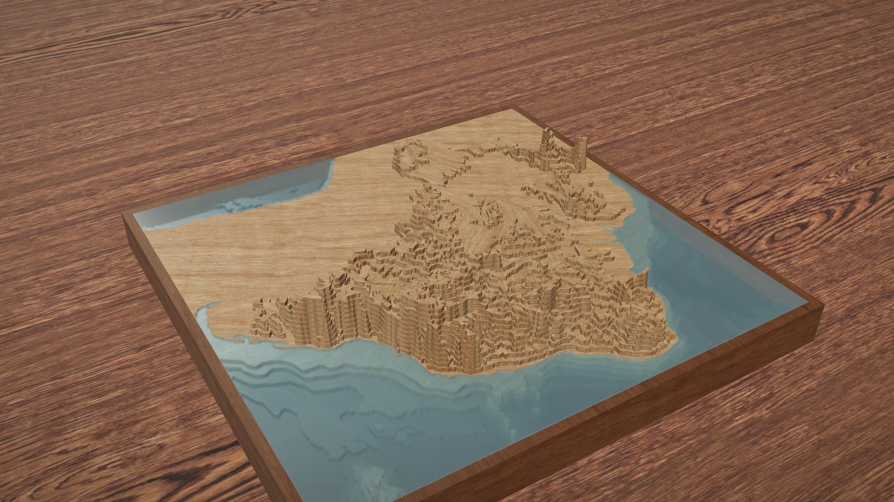
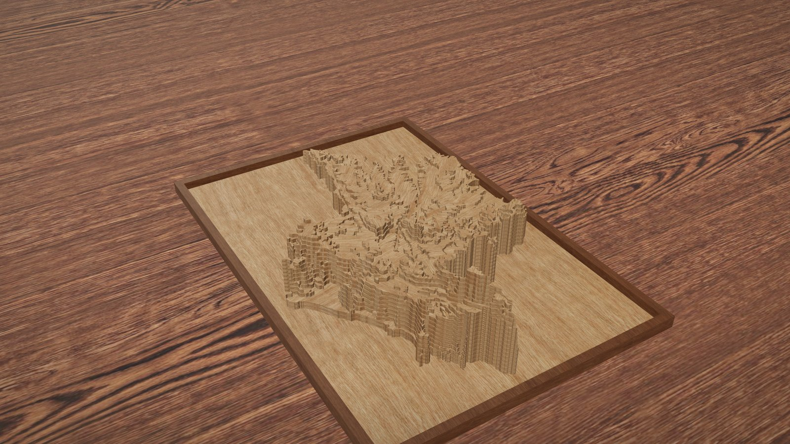
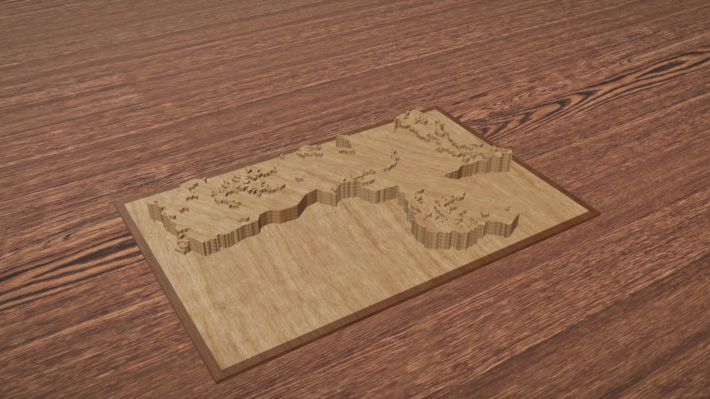
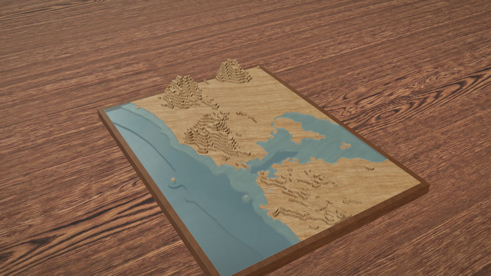
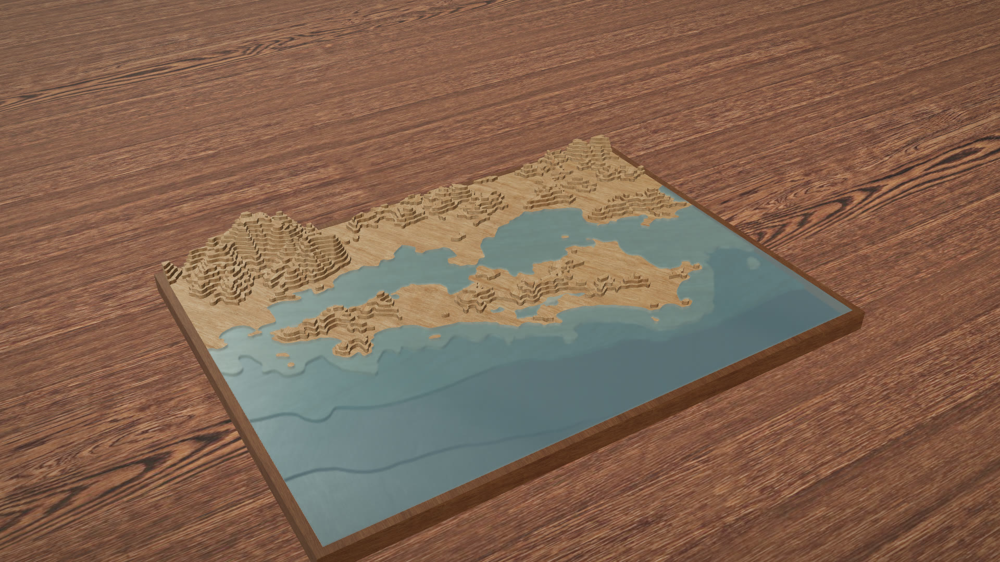
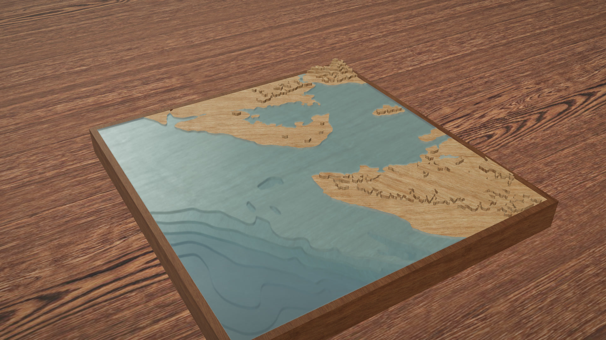
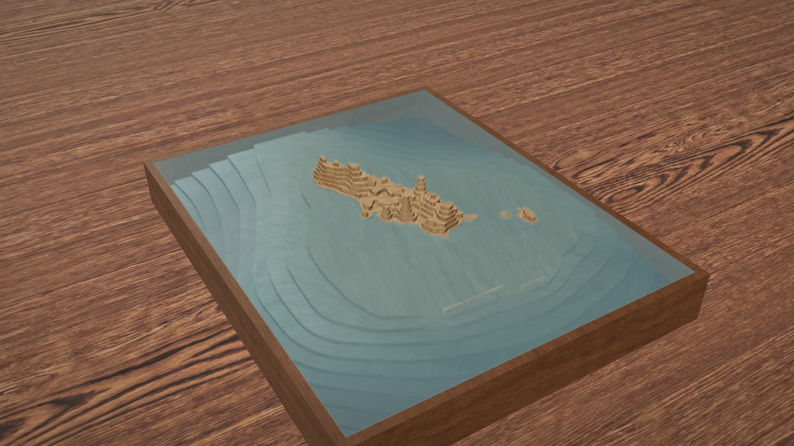

# maquete

Qualquer lugar do mundo vira uma maquete em lâminas, terra e fundo do mar, com luz de estúdio no navegador e SVG para cortar a laser ou em papel. Dado aberto, um comando, sem chave de API, sem build. Do Brasil inteiro a uma baía: cinco escalas (país, região, estado, município e local), 64 lugares já prontos.

[Read this in English](README.en.md)



|  |  |  |
|---|---|---|

|  |  |  |
|---|---|---|

## Cinco escalas

A mesma peça, de 300 mm no lado maior, serve para o país inteiro ou para uma baía. O que muda é de onde vem o contorno, de onde vem o relevo e quantos metros cada lâmina vale.

| Escala | Exemplo | Fonte do relevo | Nós da grade | Passo típico (terra / mar) | Recorte |
|---|---|---|---|---|---|
| País | `brasil` | GMRT (terra e mar), 4,5 km por nó | 1024 | 100 m / 1.000 m | caixa: vizinhos chapados em 0 m, mar com batimetria |
| Região | `regiao-sul` | GMRT, 1 a 3,3 km por nó | 1024 | 100 m / igual à terra | contorno: a peça tem o formato do território |
| Estado | `sp` | GMRT, 110 m a 2,1 km por nó | 1024 | 20 a 100 m / igual à terra, no máximo 2 lâminas | contorno |
| Município | `sao-paulo` | Copernicus até 150 km de largura, senão GMRT; 16 a 530 m por nó | 1024 | 10 a 250 m / 5 a 50 m | contorno |
| Local | `rio` | Copernicus na terra, GMRT no mar; 22 a 58 m por nó | até 2048 | 25 a 100 m / 20 a 250 m | caixa: a caixa inteira, como veio |

Nas quatro primeiras o contorno vem das Malhas Territoriais do IBGE (sem chave; ficha em `dados/fontes/ibge.md`). O relevo continua vindo do Copernicus e do GMRT; o IBGE só diz onde o território começa e termina. `local` é a caixa livre de sempre, com `--bbox`.

Um comando por escala:

```
npx maquete --pais                                   # lugares/brasil (recorte caixa por padrão)
npx maquete --regiao sul                             # lugares/regiao-sul (nome, sigla ou número 1..5)
npx maquete --uf SP                                  # lugares/sp (sigla do estado)
npx maquete --municipio "São Paulo" --uf SP          # lugares/sao-paulo (nome, acento-insensível, ou código de 7 dígitos)
npx maquete --bbox -22.72,-23.1,-43.5,-42.95 --slug meu-lugar --nome "Meu lugar"   # local, caixa livre
```

Depois de qualquer um deles, `node cli/laminas.mjs <slug>` corta as lâminas e `npm run serve` abre a página. Opções dos lugares do IBGE: `--recorte contorno|caixa`, `--qualidade minima|intermediaria|maxima`, `--margem 0.04` (folga em volta do polígono) e `--slug` para trocar o nome da pasta. A CLI escolhe sozinha a fonte do relevo, a grade de 1024 nós e a largura da peça (o lado maior fica em 300 mm); tudo fica gravado no `lugar.json`, e `npx maquete <slug>` refaz igual. Município com nome repetido (Bonito existe em quatro estados) pede `--uf`.

Aviso honesto sobre as escalas grandes. No país, nas regiões, nos estados e nos municípios com mais de 150 km de largura o exagero vertical passa de 100x (Brasil 469x, Acre 437x, Amazonas 425x): uma planície de 2.000 km cabe em 300 mm, e sem exagero o relevo sumiria. O passo é escolhido pelo percentil 99 das elevações, não pelo máximo, com as lâminas contadas a partir da base da peça (não de 0 m: o Distrito Federal, inteiro acima de 735 m, fica com 50 m em vez de 100 m), e o exagero nunca passa de 500x; quando nem 500x dá 8 lâminas de relevo, fica o menor passo permitido e a planície sai como planície (Amazonas: 50 m, 4 lâminas até o percentil). O teto é o nível logo acima do percentil 99 mais 2 passos, nunca acima de 16 passos da base: os cumes acima dele ficam achatados na última lâmina e o nível vai em `teto_m` (no Brasil, tudo acima de 1.100 m; no Amazonas, o Pico da Neblina para em 350 m). O valor é declarado no `laminas.json`, na página ("relevo 469x mais alto que o real, escala país") e na folha-chave. O fundo do mar nessas escalas não é medido: o GMRT a 1 a 4,5 km por nó é o GEBCO reamostrado (grade de cerca de 450 m por nó, modelo, não sonar); no Brasil só 0,4 % do fundo tem levantamento multifeixe. Nas regiões, nos estados e nos municípios em recorte contorno o oceano nem entra na peça: o "mar" são só os bolsões abaixo de 0 m dentro do polígono (estuários, lagoas, leito do Amazonas), cortados no passo da terra em no máximo 2 lâminas, e a base da peça é sempre terra, mesmo quando o nível mais baixo é negativo. Na terra, o GMRT em escala país e estado tem artefatos perto da costa (picos falsos de 1.600 a 3.100 m em Alagoas e Sergipe); o teto segura o visual, mas `elev_max_m` carrega o artefato.

## Lugares prontos

64 lugares já vêm com o relevo baixado e as lâminas calculadas; a página abre direto e os seletores "Escala" e "Lugar" da barra trocam entre eles. Cada lâmina tem 3 mm (compensado). "Lâminas (terra + mar)": lâminas de tipo terra (a costa, em 0 m, conta como terra; a lâmina 0 é a base, o retângulo, e no recorte contorno a lâmina 1 é o território inteiro no mesmo nível, as duas sempre terra) e lâminas de tipo mar, abaixo de 0 m. "Relevo" é a resolução da grade em metros por nó. Os números saem do `laminas.json` e do `terreno.json` de cada lugar e são os mesmos que a página mostra.

### País (1)

| Lugar | Demo | Peça (mm) | Lâminas (terra + mar) | Passo terra / mar | Exagero terra / mar | Teto | Relevo (m/nó) |
|---|---|---|---|---|---|---|---|
| Brasil | [abrir](https://victorsodre.github.io/maquete/?lugar=brasil) | 292 × 300 | 20 (12 + 8) | 100 m / 1.000 m | 469,1x / 46,9x | 1.100 m | 4.459 |

### Região (5)

| Lugar | Demo | Peça (mm) | Lâminas (terra + mar) | Passo terra / mar | Exagero terra / mar | Teto | Relevo (m/nó) |
|---|---|---|---|---|---|---|---|
| Centro-Oeste | [abrir](https://victorsodre.github.io/maquete/?lugar=regiao-centro-oeste) | 272 × 300,4 | 13 (13 + 0) | 100 m / — | 200,7x / — | 1.100 m | 1.777 |
| Nordeste | [abrir](https://victorsodre.github.io/maquete/?lugar=regiao-nordeste) | 239 × 300,4 | 15 (15 + 0) | 100 m / — | 207,6x / — | 1.200 m | 1.615 |
| Norte | [abrir](https://victorsodre.github.io/maquete/?lugar=regiao-norte) | 300 × 201,7 | 12 (11 + 1) | 100 m / 100 m | 339,1x / 339,1x | 800 m | 3.312 |
| Sudeste | [abrir](https://victorsodre.github.io/maquete/?lugar=regiao-sudeste) | 300 × 262,3 | 18 (18 + 0) | 100 m / — | 152x / — | 1.500 m | 1.485 |
| Sul | [abrir](https://victorsodre.github.io/maquete/?lugar=regiao-sul) | 224 × 300 | 18 (17 + 1) | 100 m / 100 m | 134,9x / 134,9x | 1.400 m | 983 |

### Estado (27)

| Lugar | Demo | Peça (mm) | Lâminas (terra + mar) | Passo terra / mar | Exagero terra / mar | Teto | Relevo (m/nó) |
|---|---|---|---|---|---|---|---|
| Acre | [abrir](https://victorsodre.github.io/maquete/?lugar=ac) | 300 × 166,4 | 15 (15 + 0) | 20 m / — | 437,2x / — | 380 m | 854 |
| Alagoas | [abrir](https://victorsodre.github.io/maquete/?lugar=al) | 300 × 166 | 15 (15 + 0) | 50 m / — | 73,1x / — | 600 m | 357 |
| Amapá | [abrir](https://victorsodre.github.io/maquete/?lugar=ap) | 261 × 300 | 12 (12 + 0) | 50 m / — | 138,1x / — | — | 587 |
| Amazonas | [abrir](https://victorsodre.github.io/maquete/?lugar=am) | 300 × 204,9 | 12 (10 + 2) | 50 m / 100 m | 424,8x / 212,4x | 350 m | 2.074 |
| Bahia | [abrir](https://victorsodre.github.io/maquete/?lugar=ba) | 275 × 300,1 | 15 (15 + 0) | 100 m / — | 117,8x / — | 1.200 m | 1.055 |
| Ceará | [abrir](https://victorsodre.github.io/maquete/?lugar=ce) | 246 × 300,6 | 12 (12 + 0) | 100 m / — | 60,9x / — | — | 488 |
| Distrito Federal | [abrir](https://victorsodre.github.io/maquete/?lugar=df) | 300 × 174,8 | 14 (14 + 0) | 50 m / — | 22,6x / — | — | 110 |
| Espírito Santo | [abrir](https://victorsodre.github.io/maquete/?lugar=es) | 183 × 299,4 | 17 (17 + 0) | 100 m / — | 41,1x / — | 1.400 m | 245 |
| Goiás | [abrir](https://victorsodre.github.io/maquete/?lugar=go) | 298 × 299,8 | 13 (13 + 0) | 100 m / — | 85,4x / — | 1.300 m | 829 |
| Maranhão | [abrir](https://victorsodre.github.io/maquete/?lugar=ma) | 226 × 300,6 | 14 (14 + 0) | 50 m / — | 221x / — | 550 m | 813 |
| Mato Grosso | [abrir](https://victorsodre.github.io/maquete/?lugar=mt) | 300 × 288,2 | 17 (17 + 0) | 50 m / — | 267,6x / — | 800 m | 1.307 |
| Mato Grosso do Sul | [abrir](https://victorsodre.github.io/maquete/?lugar=ms) | 295 × 300,3 | 18 (18 + 0) | 50 m / — | 165,8x / — | — | 796 |
| Minas Gerais | [abrir](https://victorsodre.github.io/maquete/?lugar=mg) | 300 × 245,8 | 18 (18 + 0) | 100 m / — | 127,5x / — | 1.600 m | 1.245 |
| Pará | [abrir](https://victorsodre.github.io/maquete/?lugar=pa) | 300 × 291,1 | 15 (14 + 1) | 50 m / 50 m | 308x / 308x | 550 m | 1.504 |
| Paraíba | [abrir](https://victorsodre.github.io/maquete/?lugar=pb) | 300 × 173,4 | 18 (18 + 0) | 50 m / — | 94,8x / — | 800 m | 463 |
| Paraná | [abrir](https://victorsodre.github.io/maquete/?lugar=pr) | 300 × 210,1 | 15 (15 + 0) | 100 m / — | 72,1x / — | — | 704 |
| Pernambuco | [abrir](https://victorsodre.github.io/maquete/?lugar=pe) | 300 × 102,2 | 11 (11 + 0) | 100 m / — | 77,9x / — | — | 761 |
| Piauí | [abrir](https://victorsodre.github.io/maquete/?lugar=pi) | 206 × 299,9 | 18 (18 + 0) | 50 m / — | 196,7x / — | — | 660 |
| Rio de Janeiro | [abrir](https://victorsodre.github.io/maquete/?lugar=rj) | 300 × 214,5 | 19 (19 + 0) | 100 m / — | 43,8x / — | 1.600 m | 428 |
| Rio Grande do Norte | [abrir](https://victorsodre.github.io/maquete/?lugar=rn) | 300 × 179,6 | 16 (16 + 0) | 50 m / — | 86,4x / — | — | 422 |
| Rio Grande do Sul | [abrir](https://victorsodre.github.io/maquete/?lugar=rs) | 300 × 291,5 | 16 (15 + 1) | 100 m / 100 m | 82,5x / 82,5x | — | 806 |
| Rondônia | [abrir](https://victorsodre.github.io/maquete/?lugar=ro) | 300 × 248,2 | 15 (15 + 0) | 50 m / — | 166,2x / — | 650 m | 811 |
| Roraima | [abrir](https://victorsodre.github.io/maquete/?lugar=rr) | 260 × 300,2 | 15 (15 + 0) | 100 m / — | 82,3x / — | 1.300 m | 697 |
| Santa Catarina | [abrir](https://victorsodre.github.io/maquete/?lugar=sc) | 300 × 210,2 | 18 (18 + 0) | 100 m / — | 58,3x / — | — | 570 |
| São Paulo | [abrir](https://victorsodre.github.io/maquete/?lugar=sp) | 300 × 200,7 | 17 (17 + 0) | 100 m / — | 99,4x / — | 1.400 m | 970 |
| Sergipe | [abrir](https://victorsodre.github.io/maquete/?lugar=se) | 266 × 300,4 | 13 (13 + 0) | 50 m / — | 49,3x / — | 500 m | 213 |
| Tocantins | [abrir](https://victorsodre.github.io/maquete/?lugar=to) | 180 × 300,2 | 18 (18 + 0) | 50 m / — | 199,4x / — | 850 m | 584 |

### Município (27)

| Lugar | Demo | Peça (mm) | Lâminas (terra + mar) | Passo terra / mar | Exagero terra / mar | Teto | Relevo (m/nó) |
|---|---|---|---|---|---|---|---|
| Aracaju (SE) | [abrir](https://victorsodre.github.io/maquete/?lugar=aracaju) | 138 × 301,1 | 7 (6 + 1) | 20 m / 10 m | 17,9x / 35,9x | — | 16 |
| Belém (PA) | [abrir](https://victorsodre.github.io/maquete/?lugar=belem) | 194 × 299,6 | 7 (6 + 1) | 10 m / 25 m | 61,1x / 24,4x | — | 39 |
| Belo Horizonte (MG) | [abrir](https://victorsodre.github.io/maquete/?lugar=belo-horizonte) | 205 × 299,1 | 18 (18 + 0) | 50 m / — | 6,8x / — | — | 23 |
| Boa Vista (RR) | [abrir](https://victorsodre.github.io/maquete/?lugar=boa-vista) | 182 × 300,4 | 6 (6 + 0) | 50 m / — | 28,3x / — | — | 84 |
| Brasília (DF) | [abrir](https://victorsodre.github.io/maquete/?lugar=brasilia) | 300 × 174,8 | 5 (5 + 0) | 200 m / — | 5,7x / — | — | 110 |
| Campo Grande (MS) | [abrir](https://victorsodre.github.io/maquete/?lugar=campo-grande) | 261 × 299,4 | 4 (4 + 0) | 250 m / — | 6,8x / — | — | 145 |
| Cuiabá (MT) | [abrir](https://victorsodre.github.io/maquete/?lugar=cuiaba) | 231 × 299,8 | 5 (5 + 0) | 250 m / — | 7,1x / — | — | 133 |
| Curitiba (PR) | [abrir](https://victorsodre.github.io/maquete/?lugar=curitiba) | 184 × 299,2 | 5 (5 + 0) | 50 m / — | 7,2x / — | — | 22 |
| Florianópolis (SC) | [abrir](https://victorsodre.github.io/maquete/?lugar=florianopolis) | 131 × 300,4 | 8 (7 + 1) | 100 m / 10 m | 7x / 69,6x | — | 30 |
| Fortaleza (CE) | [abrir](https://victorsodre.github.io/maquete/?lugar=fortaleza) | 300 × 257,7 | 6 (6 + 0) | 25 m / — | 11,4x / — | — | 28 |
| Goiânia (GO) | [abrir](https://victorsodre.github.io/maquete/?lugar=goiania) | 281 × 300,8 | 5 (5 + 0) | 100 m / — | 4,5x / — | — | 42 |
| João Pessoa (PB) | [abrir](https://victorsodre.github.io/maquete/?lugar=joao-pessoa) | 281 × 299,4 | 5 (5 + 0) | 20 m / — | 11,4x / — | — | 21 |
| Macapá (AP) | [abrir](https://victorsodre.github.io/maquete/?lugar=macapa) | 300 × 249,2 | 13 (11 + 2) | 10 m / 20 m | 193,6x / 96,8x | — | 189 |
| Maceió (AL) | [abrir](https://victorsodre.github.io/maquete/?lugar=maceio) | 221 × 299,8 | 9 (8 + 1) | 50 m / 5 m | 8,2x / 82,3x | — | 30 |
| Manaus (AM) | [abrir](https://victorsodre.github.io/maquete/?lugar=manaus) | 300 × 237,2 | 17 (15 + 2) | 10 m / 20 m | 197,3x / 98,7x | — | 193 |
| Natal (RN) | [abrir](https://victorsodre.github.io/maquete/?lugar=natal) | 211 × 300,5 | 8 (7 + 1) | 25 m / 10 m | 9,4x / 23,5x | — | 16 |
| Palmas (TO) | [abrir](https://victorsodre.github.io/maquete/?lugar=palmas) | 300 × 259,7 | 7 (7 + 0) | 100 m / — | 7,5x / — | — | 73 |
| Porto Alegre (RS) | [abrir](https://victorsodre.github.io/maquete/?lugar=porto-alegre) | 224 × 299,4 | 6 (5 + 1) | 100 m / 5 m | 4,1x / 81,2x | — | 30 |
| Porto Velho (RO) | [abrir](https://victorsodre.github.io/maquete/?lugar=porto-velho) | 300 × 134,5 | 10 (10 + 0) | 20 m / — | 271,6x / — | 200 m | 530 |
| Recife (PE) | [abrir](https://victorsodre.github.io/maquete/?lugar=recife) | 207 × 299,5 | 8 (7 + 1) | 25 m / 5 m | 10,9x / 54,5x | — | 18 |
| Rio Branco (AC) | [abrir](https://victorsodre.github.io/maquete/?lugar=rio-branco) | 300 × 158,6 | 11 (11 + 0) | 20 m / — | 111,4x / — | — | 218 |
| Rio de Janeiro (RJ) | [abrir](https://victorsodre.github.io/maquete/?lugar=rio-de-janeiro) | 300 × 157,6 | 8 (7 + 1) | 200 m / 5 m | 3,8x / 153,8x | — | 75 |
| Salvador (BA) | [abrir](https://victorsodre.github.io/maquete/?lugar=salvador-ba) | 300 × 221 | 7 (5 + 2) | 50 m / 50 m | 9,3x / 9,3x | — | 45 |
| São Luís (MA) | [abrir](https://victorsodre.github.io/maquete/?lugar=sao-luis) | 232 × 301,1 | 7 (6 + 1) | 20 m / 5 m | 19,5x / 78,1x | — | 30 |
| São Paulo (SP) | [abrir](https://victorsodre.github.io/maquete/?lugar=sao-paulo) | 194 × 299,4 | 7 (7 + 0) | 200 m / — | 3,9x / — | — | 50 |
| Teresina (PI) | [abrir](https://victorsodre.github.io/maquete/?lugar=teresina) | 139 × 300,5 | 4 (4 + 0) | 100 m / — | 9,6x / — | — | 44 |
| Vitória (ES) | [abrir](https://victorsodre.github.io/maquete/?lugar=vitoria) | 300 × 218,7 | 16 (14 + 2) | 25 m / 10 m | 6,6x / 16,6x | — | 16 |

### Local (4)

| Lugar | Demo | Peça (mm) | Lâminas (terra + mar) | Passo terra / mar | Exagero terra / mar | Teto | Relevo (m/nó) |
|---|---|---|---|---|---|---|---|
| Fernando de Noronha | [abrir](https://victorsodre.github.io/maquete/?lugar=noronha) | 300 × 240,5 | 18 (7 + 11) | 25 m / 250 m | 8,9x / 0,9x | — | 22 |
| Florianópolis | [abrir](https://victorsodre.github.io/maquete/?lugar=floripa) | 300 × 406,5 | 17 (13 + 4) | 100 m / 20 m | 4,9x / 24,7x | — | 48 |
| Rio de Janeiro e Baía de Guanabara | [abrir](https://victorsodre.github.io/maquete/?lugar=rio) | 300 × 225 | 12 (9 + 3) | 100 m / 20 m | 5,6x / 28,2x | — | 55 |
| Salvador e Baía de Todos-os-Santos | [abrir](https://victorsodre.github.io/maquete/?lugar=salvador) | 300 × 279,9 | 12 (4 + 8) | 50 m / 200 m | 11,9x / 3x | — | 58 |

Quatro capitais pequenas e planas (Boa Vista, Aracaju, São Luís e Belém) saíam com 0 ou 1 lâmina pela regra do município (exagero até 12x) e trazem o passo escolhido à mão no `lugar.json`; o exagero resultante (18x a 61x) está declarado. Os quatro municípios largos demais para o Copernicus (Rio Branco, Macapá, Manaus e Porto Velho, terra do GMRT) seguem as regras das escalas grandes: passo pelo percentil 99, exagero de 111x a 272x declarado. Quatro outros (Salvador, Campo Grande, Teresina e Porto Alegre) ficaram com 2 lâminas de terra acima da costa pela regra. Ilha oceânica fica fora da peça: a malha do IBGE inclui Trindade e Martim Vaz, 1.200 km mar adentro, no Espírito Santo e em Vitória, e a CLI só leva para o `bbox` os polígonos perto do maior (os que ficaram de fora vão contados em `ilhas_fora_do_bbox`, no `terreno.json`); Pernambuco perde Fernando de Noronha do mesmo jeito e sai inteiro na peça (779 km de largura). O município de Salvador vive em `salvador-ba`, porque `salvador` já era o local da baía.

## Usar em 30 segundos

Precisa de Node 22 ou mais. Nada de chave, nada de build.

```
git clone https://github.com/victorsodre/maquete.git
cd maquete
npm install

npx maquete --bbox -22.72,-23.1,-43.5,-42.95 --slug meu-lugar --nome "Meu lugar"
npx maquete meu-lugar
node cli/laminas.mjs meu-lugar
npm run serve
node cli/svg.mjs meu-lugar --numerar
```

O que cada passo produz:

1. `npx maquete --bbox N,S,O,L --slug meu-lugar --nome "..."` cria `lugares/meu-lugar/lugar.json` com a caixa (norte, sul, oeste, leste em graus) e já baixa o relevo. `--pais`, `--regiao`, `--uf` e `--municipio` fazem o mesmo a partir de um território do IBGE. `npx maquete meu-lugar` repete a rodada a partir do que está em `lugar.json`, usando o cache. Os dois gravam `terreno.png` (altura em Terrain-RGB; fora do recorte é -10000 m) e `terreno.json` (fontes, resolução, fração medida, recorte).
2. `node cli/laminas.mjs meu-lugar` corta o terreno em níveis e grava `laminas.json`: um polígono por lâmina, em milímetros da peça, com passo, exagero, escala, recorte e fontes. O passo é escolhido sozinho: em `local` e no município de até 150 km fica gravado no `lugar.json`; no país, nas regiões, nos estados e nos municípios largos sai da regra a cada rodada e não é gravado (um passo já presente no `lugar.json` vence a regra). Dá para forçar com `--passo-terra`, `--passo-mar`, `--largura-mm`, `--espessura-mm`, `--escala` e `--recorte`.
3. `npm run serve` sobe a página em `http://localhost:8765/?lugar=meu-lugar`: a maquete montada em 3D, com luz de estúdio, sombra entre lâminas e a placa de acrílico do mar. `npm run indice` regera `lugares/index.json`, que alimenta os seletores de escala e lugar.
4. `node cli/svg.mjs meu-lugar --numerar` grava um SVG por lâmina mais a folha-chave em `lugares/meu-lugar/svg/`, prontos para a cortadora.

## A página

A página é `index.html` com `web/app.js`; não precisa de servidor especial, só de arquivos estáticos. Ela lê o `laminas.json` do lugar e `lugares/index.json` (para os seletores), nunca o `terreno.png`.

Parâmetros de URL:

| Parâmetro | Valores | O que faz |
|---|---|---|
| `lugar` | slug (padrão `rio`) | qual pasta de `lugares/` carregar |
| `material` | `compensado`, `cartao`, `gesso` | preset de material das lâminas (padrão compensado) |
| `agua` | `0` | tira a placa de acrílico do mar |
| `levantar` | `0` a `1` | quanto a placa do mar sobe (até 25 mm) e inclina, como quem levanta com a mão |
| `moldura` | `0` | tira a moldura de madeira em volta da peça |
| `t` | segundos | ponto da volta de câmera (12 s por volta) em que a cena abre |
| `capture` | `1` | modo de captura: sem interface, sem animação, quadro fixo em `t` |
| `simples` | `1` | placa do mar sem refração (o que o celular usa sozinho) |

A barra tem dois seletores, "Escala" e "Lugar" (filtrado pela escala; estado e município mostram a UF): trocar qualquer um navega para `?lugar=<slug>`, mantendo material, água, moldura e `simples`. O título mostra o nome do lugar e, embaixo, a escala, a largura real, a peça e as lâminas ("Estado · 994 km de largura · 300 × 200,7 mm · 17 lâminas de 3 mm"); depois o exagero vertical declarado com a escala ("relevo 99x mais alto que o real, escala estado; cada lâmina de 3 mm vale 100 m na terra", mais "e 20 m no mar" quando há mar; no Brasil, "relevo 469x mais alto que o real na terra (47x no mar), escala país"); quando há teto, "cumes achatados acima de 1.400 m"; e, quando há mar, a fração do fundo medida por sonar. Tem botão "Girar" (a peça dá a volta sozinha), seletor de material, slider "Levantar o mar" e os créditos com as fontes no rodapé.

O botão "Baixar SVGs" gera, no próprio navegador e com o mesmo módulo da CLI, um SVG por lâmina mais a folha-chave, numerados. O navegador pede permissão uma vez para vários downloads.

## Cortar de verdade

Cada SVG é uma lâmina, em milímetros de verdade (`width="300mm"`, `viewBox` em mm, sem `px`, sem `transform`): a cortadora abre no tamanho certo. O traço vermelho de 0,01 mm é corte; o traço azul de 0,1 mm é gravação e desenha o contorno da lâmina de cima, para você saber onde colar a próxima. Com `--numerar`, cada lâmina leva o número e o nível em metros gravados num canto.

A `folha-chave.svg` é o verso da peça: lista das lâminas (número, nível, tipo, área), escala horizontal (1 cm na peça = X km), espessura, passo, exagero, fontes e licença.

Material: compensado de 3 mm é o padrão. Para papel-cartão, gere as lâminas com `node cli/laminas.mjs meu-lugar --espessura-mm 1.5`; o passo em metros se ajusta sozinho para manter o exagero no limite.

Kerf (a largura que o laser come): `node cli/svg.mjs meu-lugar --kerf 0.15` só registra o valor no SVG e na folha-chave; as linhas não recebem offset. Configure a compensação no LightBurn ou no software da sua cortadora.

Montagem: cole de baixo para cima, alinhando cada lâmina pelo contorno azul gravado na de baixo. A lâmina 0 é o retângulo inteiro e serve de base; no recorte contorno, a lâmina 1 é o território inteiro e as seguintes só existem dentro dele.

Aviso honesto: o corte físico ainda não foi feito pelo autor. As convenções (vermelho corta, azul grava, mm de verdade) são as das cortadoras a laser comuns, mas confira um teste pequeno antes de cortar a peça toda.

## Honestidade na peça

Nada fica escondido na maquete.

- Exagero vertical: é consequência da espessura da lâmina e do passo em metros, `exagero = (espessura_mm / passo_m) / (mm_por_km / 1000)`. É calculado, gravado no `laminas.json`, mostrado na página e impresso na folha-chave. Em `local` e `municipio` a terra fica em até 7x (até 12x em lugar muito plano, para não sair sem relevo); o mar pode ir mais alto, porque o fundo é estilizado por contornos como numa carta batimétrica, e os dois valores ficam declarados. Em `estado`, `regiao`, `pais` e no município com mais de 150 km de largura o exagero passa de 100x, nunca de 500x, e é declarado junto da escala; o nível em que os cumes foram achatados vai em `teto_m`.
- Fundo do mar: o GMRT tem sonar multifeixe onde existe levantamento e, no resto, a grade GEBCO a cerca de 450 m por nó. A fração medida de verdade vem da camada `topo-mask` e é mostrada por lugar: Rio 3,4 %, Florianópolis 1,0 %, Salvador 4,0 %, Noronha 0 %, Brasil 0,4 %. Fora dessa fração, a forma do fundo é modelo, não medição. Nas escalas país, região e estado a própria grade (1 a 4,5 km por nó) é mais grossa que o GEBCO.
- Terra: o Copernicus DEM é modelo de superfície, não de terreno. Prédio e mata entram na altura. Por isso a terra passa por uma suavização de 1 ou 2 nós antes de contornar, senão cidade vira confete de lâminas. Nas escalas grandes a terra vem do GMRT, não do Copernicus: o GMRT inclui terra, mas grosseira (GEBCO a cerca de 450 m por nó reamostrado), então a suavização sobe para `ceil(450 / metros_por_nó)` nós, como no mar (Manaus, a 193 m por nó, usa 3; com 1 nó o tampo saía em confete); perto da costa apareceram picos falsos (Alagoas 1.643 m, Sergipe 3.119 m), e o teto de lâminas segura o visual.
- Resolução real: o Copernicus vem a 30 m por nó e a grade dos locais fica entre 22 m (Noronha) e 58 m (Salvador) por nó; o GMRT devolveu entre 54 e 61 m por nó nesses quatro, mas onde não há sonar o detalhe de verdade é o do GEBCO. Nos estados a grade vai de 110 m (Distrito Federal) a 2,1 km (Amazonas) por nó; no Brasil, 4,5 km. Os valores exatos estão no `terreno.json` de cada lugar.
- Datum vertical: Copernicus (EGM2008) e GMRT (nível médio do mar) diferem em poucos metros. A fusão usa o Copernicus acima de 0,5 m e o GMRT no resto.
- Contorno: a malha do IBGE define o que é território; terra vizinha e mar fora dela são "fora" (contorno) ou chapados em 0 m (caixa). Polígono com o centróide a mais de 0,75 vez a diagonal do maior polígono (ilha oceânica) fica fora do `bbox` e da peça; o `terreno.json` conta esses em `ilhas_fora_do_bbox`. A fração de nós dentro do polígono e a chamada à API ficam no `terreno.json`.

## Captura

`node captura/quadro.mjs rio --t 3` tira um PNG da cena no tempo `t`; `node captura/capture.mjs rio --de 0 --ate 12` grava a sequência e um MP4. As duas usam o Chromium do Playwright com GPU e o quadro é determinístico: a mesma URL e o mesmo `t` dão os mesmos bytes.

## Fontes e licenças

O código é MIT (veja `LICENSE`). Os dados e os assets têm licenças próprias, com ficha completa em `dados/fontes/`.

**Copernicus DEM GLO-30** (terra em `local` e `municipio`). ESA, programa Copernicus. Licença livre e aberta com atribuição obrigatória. Como o terreno é dado adaptado (reamostrado, fundido com o GMRT, recodificado), vale o aviso do artigo 6(b):

> "produced using Copernicus WorldDEM-30 © DLR e.V. 2010-2014 and © Airbus Defence and Space GmbH 2014-2018 provided under COPERNICUS by the European Union and ESA; all rights reserved".

E o artigo 6(c), em qualquer aviso que cubra a distribuição:

> "The organisations in charge of the Copernicus programme by law or by delegation do not incur any liability for any use of the Copernicus WorldDEM-30".

**GMRT** (mar; terra em `pais`, `regiao`, `estado` e nos municípios largos). Global Multi-Resolution Topography, CC BY 4.0. Não serve para navegação. Citação exigida:

> Ryan, W. B. F., S.M. Carbotte, J. Coplan, S. O'Hara, A. Melkonian, R. Arko, R.A. Weissel, V. Ferrini, A. Goodwillie, F. Nitsche, J. Bonczkowski, and R. Zemsky (2009), Global Multi-Resolution Topography (GMRT) synthesis data set, Geochem. Geophys. Geosyst., 10, Q03014, doi:10.1029/2008GC002332.

**GEBCO** (base do GMRT onde não há sonar). Domínio público. Citação:

> GEBCO Bathymetric Compilation Group 2026 (2026). The GEBCO_2026 Grid - a continuous terrain model for oceans and land at 15 arc-second intervals. doi:10.5285/4f68d5c7-45eb-f999-e063-7086abc036fa

**IBGE** (contorno dos territórios nas escalas país, região, estado e município). Malhas Territoriais e lista de localidades, API pública sem chave. Atribuição usada: "IBGE, Malhas Territoriais". Os termos de uso do portal ficam a confirmar (a página respondeu 403 ao robô); a ficha em `dados/fontes/ibge.md` registra as chamadas feitas.

**Poly Haven** (luz e texturas), CC0 1.0: Brown Photostudio 02 (HDRI) por Sergej Majboroda; Plywood (compensado) por Rob Tuytel; Wood Table 001 (mesa) por Dimitrios Savva e Rico Cilliers.

**Bibliotecas** vendorizadas em `web/vendor/`: d3-contour, d3-array e internmap (Mike Bostock, ISC); three.js r185 (MIT).

## Para quem for mexer no código

`AGENTS.md` lista o que já quebrou e vai quebrar de novo se você não souber; `SPEC.md` é o contrato entre CLI, lâminas, página, SVG e captura (unidades, formato do `laminas.json`, escalas e recorte, `window.__maquete`). Leia os dois antes. `npm test` roda tudo e tem de passar antes de qualquer commit.

por Victor Sodré · @ovictor
